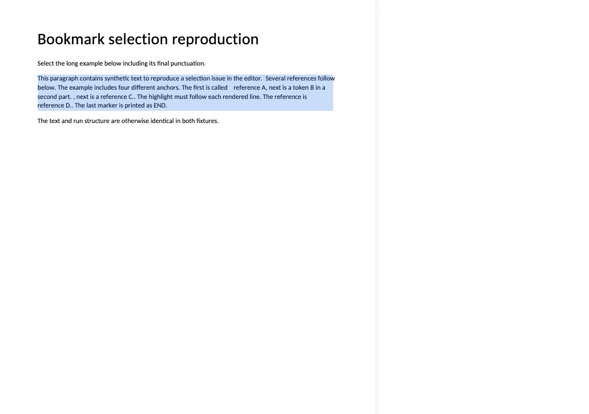
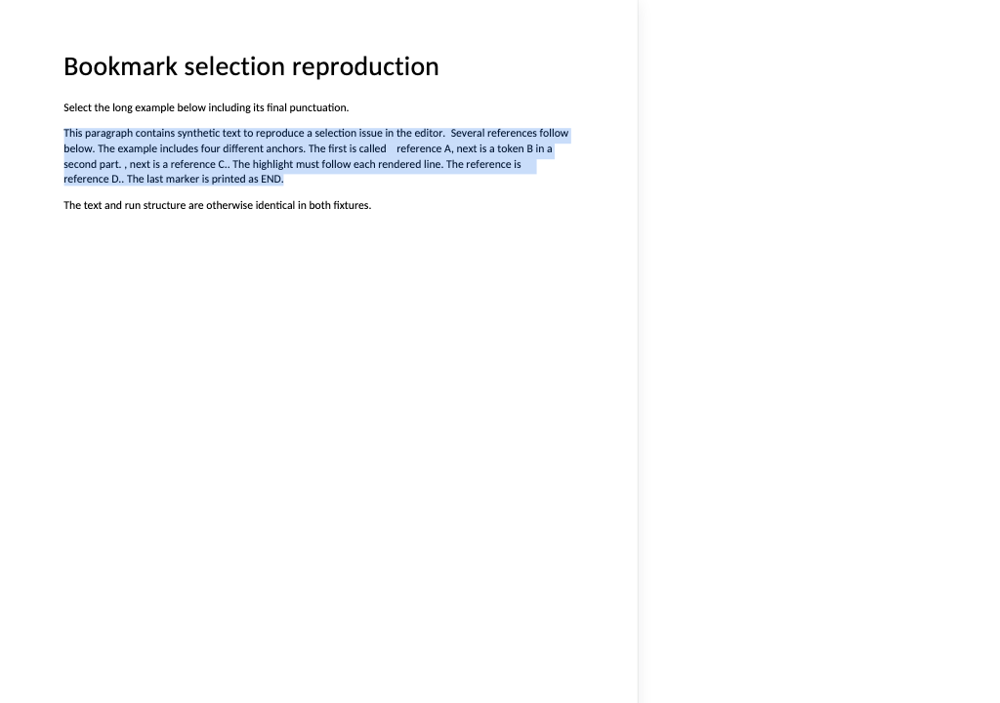

# SuperDoc bookmark selection reproduction

Selecting to the end of a bookmarked paragraph can paint a single large blue rectangle instead of separate highlights following each rendered line.

This standalone reproduction uses **SuperDoc 2.17.0**, its **DOCX engine 0.16.0**, and the Carlito substitute for Calibri. It has no application selection handlers, citation chips, React wrapper or custom editor CSS. Both DOCX fixtures are generated from invented text; no customer documents, product source, credentials or session recordings are included.

## Run the app

Requires Node.js 22 or later and npm.

```sh
npm ci
npm run dev
```

Open the local address Vite prints. The app initially loads **With bookmarks**.

1. Drag from the beginning of **This paragraph** in the long example through the final full stop after **END**.
2. Observe that the highlight becomes one paragraph-sized rectangle.
3. Click **Without bookmarks** and select the same text again.
4. Observe separate line-shaped highlights, including a shorter last line.

Stopping just before the paragraph's final full stop is another useful comparison. The supplied browser test performs both endpoint gestures.

## Automated reproduction

```sh
npx playwright install chromium
npm test
npm run build
```

The test uses real Chromium mouse input and checks the painted overlay rectangles as well as the public selection snapshot. It confirms that the complete selections in the bookmarked and control documents quote the same text.

**This test deliberately passes when the current bug reproduces.** After a vendor fix, its assertion expecting a tall bookmarked rectangle should fail. It is a diagnostic demonstration, not a test asserting desirable behaviour.

Screenshots and public snapshots are written to `evidence/`. Committed evidence shows one verified local run; rerunning replaces it.

| Comparison | Expected current observation |
| --- | --- |
| Bookmarks, stop before final punctuation | Separate line rectangles |
| Bookmarks, include final punctuation | One tall rectangle |
| No bookmarks, include final punctuation | Separate line rectangles |

### Bookmarked fixture



### Identical control without bookmarks



## Fixture structure

The files have the same text, formatting and run structure. The only difference is four `w:bookmarkStart` / `w:bookmarkEnd` pairs in the long paragraph. The bookmark names and IDs are invented. The paragraph also contains an empty `CommentReference`-styled run; there is no comment text or tracked-change data. Run boundaries and lengths are intentional, since a simpler synthetic paragraph did not reproduce the problem.

The generator is included for inspection:

```sh
python -m pip install python-docx==1.2.0
python scripts/generate_fixtures.py
```

The fixture files are already committed, so Python is unnecessary to run the app or test.

## Scope of the finding

The evidence isolates a vendor rendering problem associated with this bookmarked paragraph structure. It does not establish a specific private engine function, the release that introduced the issue, or a fix. Removing the bookmarks is a diagnostic control, not a recommended document-editing workaround: production bookmarks can carry important document identity.

SuperDoc currently logs a deprecation warning for `modules.trackChanges`. That option is retained to reproduce the reported configuration. The current public npm package and DOCX engine were verified to match the binaries used during the original investigation.

## Licences

The reproduction source is MIT licensed. SuperDoc remains subject to its own licence. The four bundled Carlito font files have their upstream notices in `public/fonts/`; the other font families listed by the upstream notice are not bundled here.
